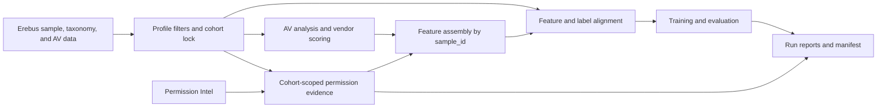
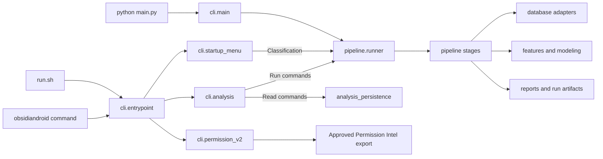

# Architecture and Component Reference

This document explains how ObsidianDroid ingests antivirus telemetry, computes reliability metrics, and produces final malware family assignments. It also maps the source tree so contributors can quickly locate the code that implements each stage.

## High-Level Flow

1. **Cohort admission.** The profile and cohort gates define the sample population before feature assembly. The runner records the population at each stage, from the fused matrix through the aligned supervised set. [`Pipeline runner`](../src/obsidiandroid/pipeline/runner.py)
2. **Permission evidence.** The report sends the same selected sample IDs to the aggregate and detailed observation readers. Aggregate counts come from raw observation rows. Detailed rows pass through permission normalization and governance before the report builds presence and signal summaries. Temporal enrichment fills missing catalog fields and preserves existing timestamps. [`Permission ingestion`](../src/obsidiandroid/pipeline/permission_trends/sample_permission_data.py)
3. **Feature assembly.** Vendor, metadata, and enabled permission features join by `sample_id`. The feature matrix can represent the governed cohort even when a vendor has no parsed row. Training then aligns that matrix with eligible labels and records any population loss. [`Feature stage`](../src/obsidiandroid/pipeline/stage_modeling.py)
4. **Reporting and persistence.** Permission summaries, correlation plots, and statistical tests reuse one table of per-sample metrics. Package-balanced reports calculate their package denominators separately from sample counts. The manifest indexes the run's artifacts, and configured runs can persist selected results. [`Permission report stage`](../src/obsidiandroid/pipeline/stage_permission_trends_report.py)

**Run-scoped path snapshot:** `obsidiandroid.pipeline.run_bounds` exposes `PipelineRunBounds` (set at the end of profile + evidence-mode path setup in `runner.py`, cleared when the run finishes). New diagnostics helpers can use `get_pipeline_run_bounds()` instead of re-deriving paths from scattered `app_config` keys. **DB settings surface:** `obsidiandroid.database.settings` provides `load_connection_settings()` as a typed view of `obsidiandroid.database.db_config` for scripts and tooling.

## Pipeline Stages in Detail

### 1. Metadata Ingestion (`obsidiandroid.database`)
- `db_config.py` centralizes MySQL credentials (including the split **primary Erebus** schema and **Permission Intel** schema via environment variables; see [`data_sources.md`](data_sources.md)).
- `db_engine.py` runs SQL against the primary DB; `execute_permission_query()` targets Permission Intel for live `android_permission_*` tables.
- `db_sample_metadata_fetchers.py`, `db_sample_metadata_queries.py`, and `db_sample_metadata_contracts.py` load cohorts and enforce query contracts.
- `db_av_engine_verdicts.py` and related modules read VirusTotal-style verdict matrices and vendor metadata.

#### VirusTotal-backed tables (primary schema)
- Typical physical names include `virustotal_vendor_engines`, `virustotal_sample_vendor_engine_verdicts`, `malware_sample_catalog`, and related summaries—see [`data_sources.md`](data_sources.md) for the authoritative list.

### 2. Label Harmonization & Vendor Scoring (`obsidiandroid.vendors`, `obsidiandroid.feature_engineering`)
- `obsidiandroid.vendors.parsing` parses vendor-specific strings into normalized tokens and families.
- `obsidiandroid/feature_engineering/compute_vendor_scores.py` derives ML-oriented vendor scores and parser gates.
- `feature_engineering/` also builds cohort statistics, pattern metrics, and supporting aggregates used in reporting.

### 3. Shared Utilities (`obsidiandroid.common`, `obsidiandroid.observability`, `obsidiandroid.reporting`)
- `obsidiandroid.observability.logging` handles structured logs and runtime tee logging.
- `obsidiandroid.common.export_naming`, `obsidiandroid.common.export_vendor_raw`, `obsidiandroid.common.export_workbook`, and `obsidiandroid.reporting.export_manager` handle workbook/Excel and raw vendor exports.
- `obsidiandroid.common.output_paths`, `obsidiandroid.governance.run_manifest`, and `obsidiandroid.cli.profile_manager` manage run IDs, manifests, and profiles.
- Use `obsidiandroid.cli.ui.display` / `obsidiandroid.cli.ui` for console UI primitives.

### 4. Model Selection & Training (`obsidiandroid.modeling`, `obsidiandroid.features`)
- `obsidiandroid.modeling.model_trainer_factory` coordinates train/test splits, optional SMOTE, and trainer dispatch.
- `obsidiandroid.modeling.pipeline_core` runs the main classifier pipeline (multiple estimators, CV optional).
- `obsidiandroid.features.vectorization.feature_vector_builder` and related modules assemble numerical feature matrices.
- Trainers live under `obsidiandroid.modeling.ml_trainers`.

Consult [`modeling_reference.md`](modeling_reference.md) for estimator-specific tips, feature group definitions, and evaluation artefact summaries.

### 5. Configuration (`config/`)
- `app_config.py` toggles feature sets, vendor inclusion criteria, and ensemble weights.
- `model_params/` holds estimator-specific hyperparameters.
- Probability/consensus behavior is driven by **`app_config`**, profile YAML under **`profiles/`**, and labeling/inference modules under **`obsidiandroid.labeling`** and **`obsidiandroid.inference`** (there is no standalone **`config/thresholds.json`** in this repository).

### 6. Execution and Import Boundaries

`./run.sh` prepends the checkout's `src/` and calls `python -m obsidiandroid.cli`. The module and installed command both call `obsidiandroid.cli.entrypoint`. The dispatcher loads the selected command, and `cli.main` parses direct pipeline arguments before loading `pipeline.runner`. The root `main.py` forwards compatibility attributes to `cli.main`, and `cli.main_override_bridge` resolves test overrides.

Library and operator script imports resolve to `src/obsidiandroid/`. Direct operator scripts use `scripts/_bootstrap.py` when they need checkout paths. Package façades such as `database`, `modeling`, `diagnostics`, and `reporting` resolve public exports on demand. The modeling menu reads `modeling.model_catalog` for supported model keys. The training and plotting libraries load when a command needs them.

- `obsidiandroid.pipeline.stage_samples` loads cohorts and applies gates; `stage_av_vendor` runs AV analysis, vendor extraction, and alignment; `stage_modeling` covers weights, feature matrix, training, and label resolution.
- `obsidiandroid.pipeline.stage_permission_trends_report` produces permission analytics (helpers under `obsidiandroid.pipeline.permission_trends`). `stage_manifest.py` writes the run manifest and paper/evidence exports.
- The permission trends stage uses one catalog read and one mapping read per run. Assignment, prevalence calculations, and exported snapshots use those same inputs. Package denominators are computed once for each type or family and reused across signals.
- The frozen A/B/C benchmark prepares one coherent AV report set per run. Both AV arms fit their engine schemas on outer-training observations. Arm C takes the readiness-eligible columns from arm B's feature matrix. The AV development experiments likewise share report preparation and fit a separate engine schema in each fold.
- `stage_results_warehouse.py` persists selected outputs when configured.
- `python -m obsidiandroid.evaluation.model_tuning` is the tuning entrypoint; `scripts/` holds operational CLIs (warehouse backfill, research utilities).
- The staged pipeline guide covers extension patterns and profile contracts. [`pipeline_staging_guide.md`](pipeline_staging_guide.md)

### 7. Quality Assurance (`tests/`, `scripts/dev/`)
- `tests/` is the primary pytest tree (`pytest -q`); `tests/conftest.py` routes outputs to tmp and guards filesystem writes during tests.
- `scripts/dev/data_fuzzer.py` stresses data transforms; `scripts/dev/run_ml_static_scan.py` (`python -m scripts.dev.run_ml_static_scan` or `make ml-scan`) calls `scan_ml_predict_misuse` for leakage-style static checks.

## Data Contracts

| Artifact | Producer | Consumer | Notes |
| --- | --- | --- | --- |
| Vendor verdict frames | `obsidiandroid.database.db_av_engine_verdicts` | `obsidiandroid.pipeline.stage_av_vendor` | Wide per-sample vendor matrix for parsers. |
| Sample cohort DataFrames | `obsidiandroid.database.db_sample_metadata_queries` | `obsidiandroid.pipeline.stage_samples` | Filtered by profile/type slug. |
| Feature matrix | `obsidiandroid.pipeline.stage_modeling` (`build_feature_matrix_stage`) | `run_feature_alignment_stage`, training | Mix of AV-derived columns and optional permission/metadata features. |
| Run manifest JSON | `obsidiandroid.pipeline.stage_manifest` | Operators, evidence bundles | Lists artifacts and run provenance. |

## Extending the System

1. Add new feature builders under `src/obsidiandroid/feature_engineering/` or via pipeline stages, and gate them in `config/app_config.py` / profile YAML.
2. Add or wire estimators through `obsidiandroid.modeling.model_trainer_factory` and `config/settings/model_hyperparams.py`.
3. Extend `tests/` and run `pytest -q` before submitting changes.
4. Document operator-visible behaviour in [`user_guide.md`](user_guide.md) or [`data_sources.md`](data_sources.md) when changing DB contracts or outputs.

## Observability and research-facing audits (`obsidiandroid.observability.pipeline_observability`)

- **`obsidiandroid.observability.pipeline_observability`** centralizes structured pipeline narration: taxonomy (`LogCategory`, `LogSeverity`), `PipelineObservabilitySession` (append-only `pipeline_events.jsonl` + `pipeline_stage_summary.csv`), stable helpers in `api.py` (`record_data_population_change`, `record_artifact_write`, etc.), and `finalize_pipeline_observability` which emits `run_observability_summary.json` (authoritative), `pipeline_stage_summary.md`, `partial_failures.md`, and logging audit artifacts.
- **Runner integration:** canonical `obsidiandroid.pipeline.runner` owns stage timing and wires population/schema transitions into the session; manifest finalization (`obsidiandroid.pipeline.stage_manifest`) calls finalize so terminal **Run Health** (`run_health.py`) and `run_evidence_index.md` stay aligned with `run_summary.json` / `run_manifest.json`.
- **Research validity & hostile audit:** `obsidiandroid.diagnostics.research_validity.bundle` orchestrates cohort funnel, claim audit, permission audit, and delegates to `obsidiandroid.diagnostics.hostile_audit`; exported paths feed the manifest and observability rollup.

By following this guide, contributors can map requirements to the correct modules and understand how data flows through ObsidianDroid.
